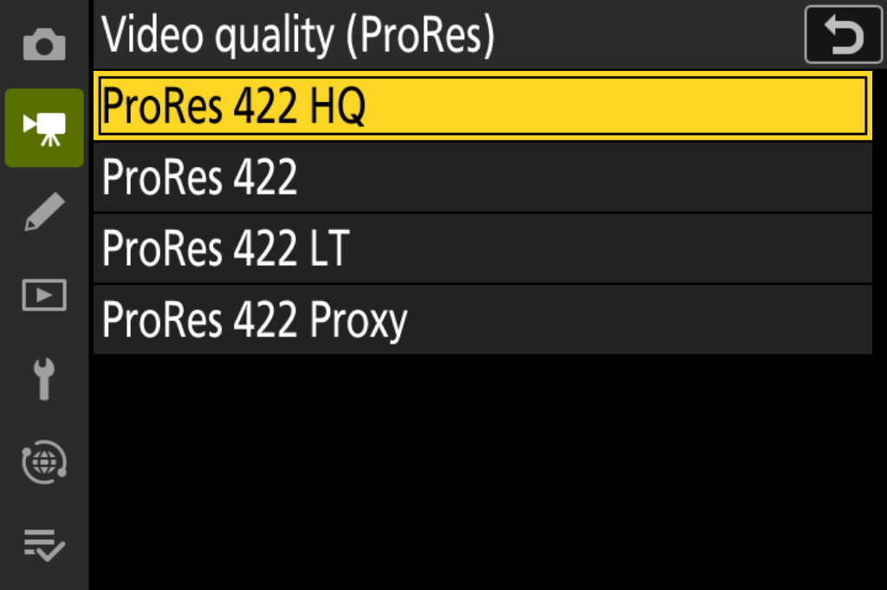
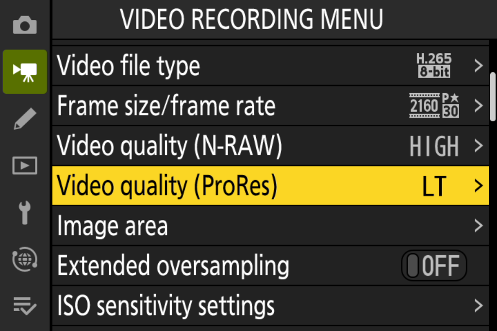

# NikonFirmwarePatch

[English](#english) · [简体中文](#简体中文)

## English

Build a local Nikon Z8 firmware update with the features you select:

- **ProRes quality:** HQ / Standard / LT / Proxy, with separate settings for shooting menu banks A/B/C/D.
- **C15/C30 HE RAW capture:** select RAW / RAW+JPEG / JPEG in the ordinary Image quality menu, for both pre-release history and full-press/post-release frames. Both NEF modes include a full-size embedded preview and direct playback.
- **Both features in one build.**

**Experimental firmware — install at your own risk.** A successful build or test does not guarantee safe operation. Installation or use may cause lost images, corrupted cards, camera malfunction or permanent camera damage. You must assess and accept these risks before installing. To the extent permitted by applicable law, the repository, its authors and contributors provide no warranty and accept no liability for data loss, camera damage or other losses caused by building, installing or using the output. Do not use it for irreplaceable work. See [LICENSE](LICENSE) and [NOTICE.md](NOTICE.md).

The publicly supported input is **official Nikon Z8 C 3.11**. Download it yourself from [Nikon](https://downloadcenter.nikonimglib.com/en/download/fw/606.html), subject to Nikon's terms. The source repository contains code, compatibility fingerprints and the existing menu screenshots. **Releases also provide the reviewed precompiled patch, with its corresponding source. No original or modified complete firmware, or RAW photos, are distributed.** Output firmware is generated locally. The tool does not copy files to a card or operate a camera.

### Build

Download and extract **[NikonFirmwarePatch-v0.1.0-toolkit.zip](https://github.com/XinmiaoZhao/NikonFirmwarePatch/releases/download/v0.1.0/NikonFirmwarePatch-v0.1.0-toolkit.zip)** from the [Release](https://github.com/XinmiaoZhao/NikonFirmwarePatch/releases/tag/v0.1.0). Use the toolkit asset, which includes `resources/precapture.bin`; GitHub's automatically generated source archives and a Git clone contain source only. The toolkit release number is unrelated to the output firmware version you choose.

Requires Python 3.10+ and the pinned Python dependency. **The default prebuilt mode does not need Clang.** It checks the bundled machine code against the published size and SHA-256 before applying it. Missing or incorrect code stops the build; there is no automatic download, compilation fallback or force option. ProRes patches continue to be generated in Python and checked against their unchanged recipe.

Run the commands below from the extracted toolkit directory. On Windows, create the environment with `py -3 -m venv .venv` and activate it in PowerShell with `.\.venv\Scripts\Activate.ps1`, then use the same `python` commands. The macOS/Linux activation commands are shown below. Full firmware integration tests for this release ran on macOS; Windows/Linux complete builds have not yet been independently exercised.

```sh
python3 -m venv .venv
source .venv/bin/activate
python -m pip install -r requirements.txt

# Read-only compatibility check for the selected features
python patch.py "/path/to/Z_8_0311.bin" --features prores precapture --check

# Choose one of these builds; each output directory must be new
python patch.py "/path/to/Z_8_0311.bin" --features prores --version 04.03 --output build/prores
python patch.py "/path/to/Z_8_0311.bin" --features precapture --version 04.03 --output build/precapture
python patch.py "/path/to/Z_8_0311.bin" --features prores precapture --version 04.03 --output build/combined

# Or select the features interactively
python patch.py "/path/to/Z_8_0311.bin" --interactive --version 04.03 --output build/chosen

# Independent verification of the combined build
python verify.py "/path/to/Z_8_0311.bin" "build/combined/Z_8_0403.bin" --features prores precapture --version 04.03 --tag p0
```

Developers can explicitly compile from the corresponding source, including from a source-only checkout:

```sh
python patch.py "/path/to/Z_8_0311.bin" --features prores precapture --version 04.03 --code-source source --compiler clang --output build/from-source
```

The reviewed compiler is **Apple clang 21.0.0 (clang-2100.1.1.101)** with the AArch64 target. Another toolchain is accepted only if the compiled bytes and entry addresses match the reviewed recipe. `--compiler` requires `--code-source source`; it does not silently switch the default mode. Source and prebuilt modes use the same patch bytes and independent verifier. See [release contents and verification](docs/releases.md).

Without `--features` or `--interactive`, the legacy ProRes-only behavior is retained. `--version` accepts `NN.NN`; the example is not a required version. Choose a number higher than both the input and the firmware installed on your camera. The tool checks only the input version, not the camera. `--tag` is an optional lowercase letter and digit, default `p0`. A changed version number does not add compatibility or guarantee that the camera will accept an update. Downgrade/recovery is not guaranteed.

The output directory contains the update package, `manifest.json` and `SHA256SUMS.txt`. A pre-capture build also supplies **`Z8PRE.CFG`**, enabling ordinary-menu control for C15/C30. **Regenerate and replace old files: this release requires v3 configuration.** RAW/JPEG choices now come from the camera, so the former `--capture-mode`, `--frames` and `--c15-only` switches are removed. Build upgrades from a fresh official package, not an earlier pre-capture output. Inputs and existing output directories are never overwritten.

### Before using RAW pre-capture

Read the full [preparation, shooting and limitations guide](docs/raw-precapture.md#english) before installing. In particular:

- Use photo mode, **FX / full-size L, C15 or C30**, and put the new `Z8PRE.CFG` on **one card only**. Choose RAW, RAW+JPEG or one of six JPEG qualities in **MENU → Photo shooting menu → Image quality settings → Image quality**.
- **Both pre-release and full-press/post-release frames follow that choice**, including when pre-release capture is off. The history window remains up to one second / 30 frames; this is not a 30-frame limit on the full burst.
- **RAW and RAW+JPEG NEFs both embed 8256×5504 previews.** JPEG fine/normal/basic, with or without ★, are effective. RAW remains HE only; the RAW recording menu does not enable lossless or HE★ here.
- Successful NEFs enter the stock database for direct playback. The immediate RAW label may omit **L** until a restart, although the files record Large. **i-menu/dial shortcuts and the shooting display still show HSFC quality**, which may disagree with the ordinary menu this feature uses.
- Wait for writing to catch up. The “!” indicator can coincide with unavailable pre-capture history; one stress trigger saved current frames with no history. This does not provide unlimited sustained RAW capture. C60/C120, DX, HLG/HEIF and unsupported dual-card arrangements remain outside the added function.

### ProRes quality

The ProRes feature retains four quality choices, matching MOV identifiers and playback labels, quality-dependent recording-time estimates, and per-bank persistence. Its original patch bytes are unchanged. The shooting-screen icon does not identify the selected quality. Menu reset and bank-settings import/export remain unverified; bitrate varies with scene content.

These screenshots show the firmware UI in an emulator, not a camera recording test.

| Four options | Selected LT value |
|---|---|
|  |  |

### Verification and scope

The package has five modules and is 99,051,117 bytes. Both the builder and independent verifier require the exact official C 3.11 input SHA-256, then check its container and dependency fingerprints. Modified and previously patched inputs are rejected. Output verification checks selected patch bytes, the approved shared loader, version instructions and strings, module identity, recalculated integrity fields, and every byte outside the allowed edits. The builder passes the requested features, version and tag explicitly to the verifier.

A fixed whole-output hash applies only to a fixed input, feature selection, version and tag. Custom outputs are checked against the published per-feature recipes and identity rules. Their locally generated hashes identify the files for later readback; a locally generated hash alone is not proof of a correct build. When running `verify.py` separately, supply `--features`, `--version` and `--tag` to check your intended options. Omitting them checks detected features and consistent identity and reports that distinction.

Hardware records for the current implementation contain **328 C15/C30 HE NEFs: 256 historical and 72 full-press/post-release frames**, plus an ordinary single-shot regression. All 328 passed file checks and complete Adobe DNG Converter 18.1.1 decoding, including full-size embedded previews. Menu tests covered RAW, RAW+JPEG fine/basic/fine★ and JPEG normal★; all six JPEG grades and the menu-setting composition also have bounded machine-code coverage.

Frame correspondence was checked by automated image comparison, supplemented by visual review where repeated timer readings made the score ambiguous. The reviewed readings matched their own RAW/JPEG frames; no frame mismatch was identified. This is limited implementation testing, **not hardware certification of each newly generated public package or feature combination**. See the [validation scope](docs/validation.md).

```sh
python tests/validate.py --stock "/path/to/Z_8_0311.bin" --report build/prores-tests.json
python tests/validate_features.py --stock "/path/to/Z_8_0311.bin" --report build/feature-tests.json
# Developer equivalence tests also need the reviewed compiler
python tests/validate_distribution.py --stock "/path/to/Z_8_0311.bin" --compiler clang --report build/distribution-tests.json
python tools/check_repository.py --staged
```

Tests use local temporary directories, without a camera. Enable the repository hook with `git config core.hooksPath .githooks`.

### Outlook and license

A future Log3G10 firmware option may be explored. It is not implemented, offered or promised by this release.

Original tool code is [GPL-3.0-only](LICENSE); Nikon firmware is not relicensed. Attribution and licensing scope are in [NOTICE.md](NOTICE.md). This project is not affiliated with Nikon.

### Acknowledgements

Thanks to [RdWing/z8-qemu](https://github.com/RdWing/z8-qemu) for its Z8 emulation work, [WonderLantern/z9-qemu](https://github.com/WonderLantern/z9-qemu) for the upstream camera model and tools, [WonderLantern/z7-qemu](https://github.com/WonderLantern/z7-qemu) for emulator and protocol references, and [QEMU](https://www.qemu.org/) for the emulation infrastructure. These projects helped the offline development and validation work; their code and binaries are not distributed here. See [NOTICE.md](NOTICE.md).

## 简体中文

从用户自行提供的 Nikon Z8 固件构建所选功能：

- **ProRes 画质选择**：HQ／Standard／LT／Proxy，A/B/C/D 拍摄菜单库分别保存档位。
- **C15／C30 HE RAW 连拍与预拍**：在普通“画质”菜单选择 RAW／RAW+JPEG／JPEG，预拍历史帧及全按后正式帧都生效；两种 NEF 模式均带全尺寸内嵌预览并支持直接回放。
- **可同时选择两项功能，构建一个更新包。**

**这是测试版固件，上机风险由使用者自行衡量和承担。** 构建、校验或既有测试通过不保证安全。安装或使用可能导致照片丢失、存储卡损坏、相机故障乃至永久损坏。在适用法律允许的范围内，本仓库及其作者、贡献者不作任何担保，不对构建、安装或使用本项目产物造成的数据损失、相机损失或其他损失承担责任。请勿用于不可重拍的重要工作。详见 [LICENSE](LICENSE) 和 [NOTICE.md](NOTICE.md)。

公开支持范围仅为**官方 Nikon Z8 C 3.11 固件**。请自行从 [Nikon 下载中心](https://downloadcenter.nikonimglib.com/en/download/fw/606.html)获取并遵守其条款。代码库提供源码、兼容性指纹及原有菜单截图；**Release 另提供已审阅的预编译补丁及对应源码，不提供原厂或修改后的完整固件，也不提供原始照片。** 完整固件在用户本地生成；脚本不会自动写卡或操作相机。

### 构建

从 [Release 页面](https://github.com/XinmiaoZhao/NikonFirmwarePatch/releases/tag/v0.1.0)下载并解压 **[NikonFirmwarePatch-v0.1.0-toolkit.zip](https://github.com/XinmiaoZhao/NikonFirmwarePatch/releases/download/v0.1.0/NikonFirmwarePatch-v0.1.0-toolkit.zip)**。请选这个完整工具包：其中含 `resources/precapture.bin`；GitHub 自动生成的 Source code 压缩包和 Git 克隆只有源码。工具包版本与用户选择的固件版本号无关。

需要 Python 3.10+ 和固定的 Python 依赖。**默认使用预编译机器码，不需要 Clang。** 应用前核对机器码大小及公开 SHA-256；缺失或不符立即停止，不自动下载、不回退编译，也没有强制跳过选项。ProRes 仍由 Python 生成修改字节并匹配原有配方。

在解压后的工具包目录运行以下命令。Windows 可用 `py -3 -m venv .venv` 创建环境，在 PowerShell 中用 `.\.venv\Scripts\Activate.ps1` 激活，然后运行相同的 `python` 命令。下方展示 macOS／Linux 的激活方式。本次完整固件集成测试运行于 macOS；尚未独立实测 Windows／Linux 上的完整构建。

```sh
python3 -m venv .venv
source .venv/bin/activate
python -m pip install -r requirements.txt

# 对所选功能只读检查
python patch.py "/path/to/Z_8_0311.bin" --features prores precapture --check

# 三选一；输出目录必须尚不存在
python patch.py "/path/to/Z_8_0311.bin" --features prores --version 04.03 --output build/prores
python patch.py "/path/to/Z_8_0311.bin" --features precapture --version 04.03 --output build/precapture
python patch.py "/path/to/Z_8_0311.bin" --features prores precapture --version 04.03 --output build/combined

# 或使用交互选择
python patch.py "/path/to/Z_8_0311.bin" --interactive --version 04.03 --output build/chosen

# 独立核验组合包
python verify.py "/path/to/Z_8_0311.bin" "build/combined/Z_8_0403.bin" --features prores precapture --version 04.03 --tag p0
```

开发者可显式选择源码编译，只有源码的克隆也可以这样使用：

```sh
python patch.py "/path/to/Z_8_0311.bin" --features prores precapture --version 04.03 --code-source source --compiler clang --output build/from-source
```

当前审阅的编译器是支持 AArch64 的 **Apple clang 21.0.0 (clang-2100.1.1.101)**。其他工具链只有生成完全相同的补丁字节和入口地址才会被接受。`--compiler` 必须配合 `--code-source source`，不会暗中切换默认模式。两条路径使用相同补丁和独立验证器，详见[发布包与验证说明](docs/releases.md)。

未指定 `--features` 或 `--interactive` 时，保留原先只添加 ProRes 的行为。`--version` 接受 `NN.NN`；示例不是规定版本。输出号必须高于输入号，安装时还须高于机身当前版本。脚本只能检查输入包，不读取机身版本。`--tag` 为一个小写字母加一位数字，默认 `p0`。改变版本号不代表支持其他固件布局，也不保证相机受理更新；不保证可以降级或恢复。

输出目录包含更新包、`manifest.json` 和 `SHA256SUMS.txt`。选择预拍摄功能后还生成 **`Z8PRE.CFG`**，启用 C15／C30 的普通菜单控制。**本版需要 v3 配置，旧文件须重新生成并替换。** RAW／JPEG 改由机内选择，原 `--capture-mode`、`--frames` 和 `--c15-only` 参数已移除。升级时从全新的官方包构建，不叠加到旧预拍输出；脚本不覆盖输入或已有输出目录。

### RAW 预拍摄使用前必读

安装前请完整阅读[准备流程、拍摄步骤和限制](docs/raw-precapture.md#简体中文)。主要注意事项：

- 照片模式、**FX／全尺寸 L、C15 或 C30**，新 `Z8PRE.CFG` 只放在**一张卡的根目录**。通过 **MENU → 照片拍摄菜单 → 画质设置 → 画质** 选择 RAW、RAW+JPEG 或 JPEG 六档。
- **预拍历史帧、全按当帧和之后的正式帧都采用该选择**，关闭预拍也生效。历史窗口仍最长一秒／30 张，不代表整次拍摄最多 30 张。
- **RAW 和 RAW+JPEG 的 NEF 都内嵌 8256×5504 预览。** JPEG fine／normal／basic 及各自 ★ 均生效；RAW 只支持 HE，普通“RAW 记录”设置不会启用无损或 HE★。
- 正常 NEF 登记到原厂照片库，写完可直接回放。刚拍完 RAW 标签可能没有 **L**，重启后恢复，但文件已记录 Large。**i 菜单／拨盘快捷设置和取景显示仍对应 HSFC 画质**，可能与实际采用的普通菜单不一致。
- 等写卡追上后再继续。“!”可能伴随历史缓存不可用；压力试验曾有一次只保存正式帧、没有预拍历史。这不保证无限持续 RAW 拍摄。C60／C120、DX、HLG／HEIF 及未支持的双卡安排不在新增功能范围内。

### ProRes 画质

保留四档画质、对应 MOV 编码标识与回放档名、按档位估算录制时间，以及菜单库分别保存设置。原有 ProRes 补丁字节保持不变。拍摄画面的图标不显示具体画质；重设视频菜单、设置文件导入／导出仍未验证；实际码率随场景变化。上方两张图是模拟器界面，不代表相机录制测试。

### 核验与支持边界

支持的更新包为五模块、99,051,117 字节。构建器与独立验证器都强制要求官方 C 3.11 的整包 SHA-256，再检查封装、依赖和修改位置指纹；修改过的输入或旧补丁产物会被拒绝。输出检查覆盖所选补丁字节、允许的共享装载修改、版本指令与字符串、模块名、重算的校验字段，以及修改范围之外的每个字节。构建器明确传入用户指定的功能、版本和 tag，独立核对输出是否符合选择。

固定整包哈希只适用于输入、功能组合、版本和 tag 全部固定的构建。自定义产物通过公开功能配方及版本规则核验；本地产生的哈希用于后续读回确认，不能单凭“生成了哈希”证明构建正确。单独运行 `verify.py` 时，传入 `--features`、`--version`、`--tag` 可核对预期选项；省略时检查实际检测出的功能和版本一致性，报告会区分两者。

当前实现的上机记录包含 **328 张 C15／C30 HE NEF：256 张历史帧、72 张全按当帧及后拍帧**，另有普通单拍回归。328 张全部文件检查和 Adobe DNG Converter 18.1.1 完整解码通过，均带全尺寸内嵌预览。菜单上机覆盖 RAW、RAW+JPEG fine／basic／fine★ 及 JPEG normal★；六档 JPEG 和菜单三项组合另有原指令限定执行覆盖。

画面对应通过自动图像比对检查，并对计时器重复读数造成的评分歧义进行了目视复核；复核读数与本帧 RAW／JPEG 一致，未发现帧错配。这是有限的实现测试，**不是每个公开新包或功能组合的上机认证**。详细边界见[验证范围](docs/validation.md)。

```sh
python tests/validate.py --stock "/path/to/Z_8_0311.bin" --report build/prores-tests.json
python tests/validate_features.py --stock "/path/to/Z_8_0311.bin" --report build/feature-tests.json
# 开发者等价性测试另需已审阅编译器
python tests/validate_distribution.py --stock "/path/to/Z_8_0311.bin" --compiler clang --report build/distribution-tests.json
python tools/check_repository.py --staged
```

测试只使用本地临时目录，不访问相机。可用 `git config core.hooksPath .githooks` 启用提交检查。

### 展望与许可

后续可能研究 Log3G10 固件选项；本次不实现、不提供，也不承诺交付时间。

工具原创代码采用 [GPL-3.0-only](LICENSE)，不改变 Nikon 固件的许可。来源和许可范围见 [NOTICE.md](NOTICE.md)。本项目与 Nikon 无隶属关系。

### 致谢

感谢 [RdWing/z8-qemu](https://github.com/RdWing/z8-qemu) 的 Z8 仿真工作、[WonderLantern/z9-qemu](https://github.com/WonderLantern/z9-qemu) 的上游相机模型与工具、[WonderLantern/z7-qemu](https://github.com/WonderLantern/z7-qemu) 的模拟器与协议参考，以及 [QEMU](https://www.qemu.org/) 的仿真基础设施。它们为本项目的离线开发和验证提供了帮助；本仓库不分发这些项目的源码或二进制。详见 [NOTICE.md](NOTICE.md)。
